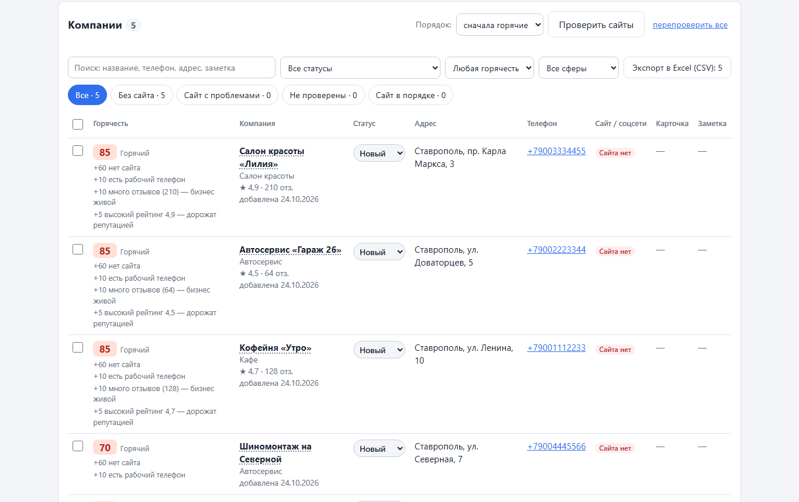

# Lead Finder

Программа для поиска клиентов на создание сайтов. Она находит малый бизнес города
(кафе, автосервисы, салоны, магазины) в открытой карте OpenStreetMap, проверяет их сайты
и показывает, кому сайт нужен больше всего: у кого его нет, у кого он не открывается или устарел.



*На скриншоте вымышленные компании.*

## Что умеет

- **Автопоиск** компаний по городу и сферам через OpenStreetMap (Nominatim и Overpass), без парсинга 2ГИС и Яндекс Карт.
- **Проверка сайтов**: открывается ли, есть ли HTTPS и мобильная версия, не заглушка ли, не конструктор ли, свежий ли год в подвале.
- **Горячесть 0–100** с объяснением, за что начислены баллы, и сортировка «сначала горячие».
- **Мини-CRM**: статусы, дата контакта, напоминания, заметки и история изменений.
- **Черновик персонального предложения** для каждой компании.
- **Импорт** из CSV (в том числе из Excel) и **экспорт** в CSV для русского Excel.
- Работает только на компьютере пользователя: отдельная программа для Windows (Electron) или страница в браузере.

## Стек

- **Node.js 22.13+** со встроенными модулями: `node:http`, `node:sqlite` (с миграциями и резервной копией перед ними), `node:test`.
- **SQLite** — база компаний.
- **HTML, CSS и JavaScript** без фреймворков, страница без `innerHTML`.
- **Electron** — сборка в программу `.exe` с ярлыком.
- **120+ автотестов**, сеть в тестах подменяется.

## Быстрый старт

```bash
npm start
```

Затем откройте http://localhost:3001. Внешние пакеты для этого не нужны, `npm install` требуется только для сборки программы (`npm run build:app`).

---

# Руководство пользователя


Помощник для поиска клиентов на создание сайтов и лендингов: база малого бизнеса
(кафе, автосервисы, магазины, салоны…), которому нужен сайт.

Программа сама находит компании города в открытой карте OpenStreetMap, проверяет их сайты
и показывает, кому сайт нужен: у кого его нет, у кого он не открывается или устарел.
Работает только на твоём компьютере.

**Версия 1.0** (18.10.2026) — все этапы исходного плана готовы. Что можно сделать дальше —
в разделе «Как вернуться к проекту» в конце файла.

## Как запустить

### Как отдельную программу (основной способ)

Дважды кликни ярлык **«Lead Finder»** на рабочем столе или найди его в меню «Пуск».
Откроется окно программы — без адресной строки и вкладок. Закрыл окно — программа выключилась.

Сама программа лежит в `dist\Lead Finder-win32-x64\Lead Finder.exe`. Внутри — Electron
(Chromium + Node.js 24) и копия кода проекта.

**После изменений в коде программу нужно пересобрать** — иначе ярлык запустит старую версию:

```
npm run build:app
```

Сборка занимает несколько секунд и заодно обновляет ярлыки. Если ярлыки не нужны:
`npm run build:app -- --no-shortcuts`. Первый раз перед сборкой нужно поставить инструменты:
`npm install` (скачается Electron, ~100 МБ).

Без сборки, прямо из папки проекта: `npm run app`.

### Как страницу в браузере

1. Нужен Node.js версии 22.13 или новее (проверить: `node --version`).
2. Дважды кликни **`start-leads.cmd`**. Откроется чёрное окно сервера, а через 2 секунды —
   страница в браузере на http://localhost:3001.
3. Пока программа нужна, окно сервера не закрывай. Чтобы остановить — закрой окно
   (или нажми в нём Ctrl+C).

Запуск из терминала (то же самое): `npm start`.

### Одна база на оба способа

И программа, и страница в браузере работают с одним файлом — `data/leads.db` в папке проекта.
Если папку проекта удалить или перенести, программа заведёт свою базу в
`%APPDATA%\Lead Finder\leads.db`. Где именно лежит база — меню **Файл → Открыть папку с базой данных**
или **Справка → О программе**.

## Как работать

1. **Автопоиск.** Впиши город, отметь сферы и нажми «Найти компании». Через 30–60 секунд
   программа покажет, сколько нашлось компаний без своего сайта и со своим сайтом.
2. Нажми **«Добавить в базу»**. Компании со своим сайтом программа сразу начнёт проверять —
   ход проверки виден над таблицей.
3. Таблица отсортирована по **горячести**: сверху — самые перспективные клиенты, у каждого
   написано, почему. Вкладки **«Без сайта»** и **«Сайт с проблемами»** — это твои клиенты.
4. Перед тем как писать компании, открой её в 2ГИС: там часто есть телефон, которого
   нет в OpenStreetMap. Быструю вставку можно использовать, чтобы дозаполнить данные вручную.

## Что умеет сейчас (этапы 1–6 + программа и удаление)

### Работа с клиентами (этап 5)

- **Статус** прямо в таблице — выпадающий список: Новый → Написал → Ответил → Встреча → Клиент / Отказ.
  Каждая смена статуса записывается в историю (видна в карточке компании).
- **Дата следующего контакта.** Поставил «Написал / Ответил / Встреча» без даты — программа сама
  напомнит через 3 дня. «Отказ» убирает напоминание. Под статусом видно «связаться сегодня»
  или «просрочено». В шапке и над таблицей — счётчик 🔔 «Связаться сегодня: N · просрочено: M»,
  по клику показывает только этих компаний.
- **Карточка компании** — клик по названию: можно исправить любые поля, статус, дату контакта
  и заметку. Если правка сделает компанию дублем другой — программа предупредит. Поменял сайт —
  старая проверка сайта сбрасывается (нажми «Проверить сайты»).
- **Фильтры:** поиск по названию, телефону (как угодно: «8 918 111», «918-111»), адресу и заметке;
  статус (в том числе «в работе» и «связаться сегодня и просроченные»); горячесть; сфера.
  Порядок: «сначала горячие» (клиенты и отказы — внизу), «по дате контакта», «сначала новые».
- **Экспорт в Excel (CSV)** — выгружается ровно то, что видно в таблице (с фильтрами и порядком).
  Файл открывается в Excel двойным кликом: UTF-8 с BOM, разделитель «;», телефон с «+»,
  рейтинг с запятой. Ячейки, начинающиеся с «=», «+», «-», «@», обезврежены — это защита
  от «формул-ловушек» в данных.

### Загрузка из файла (этап 7, часть 1)

В разделе «Добавить компанию» — кнопка **«Загрузить список из файла CSV»**.

- Подходит наш экспорт (статусы и даты контакта восстанавливаются) и любая своя таблица:
  нужен столбец «Название» (или «Наименование», «Компания»), остальные — по желанию:
  телефон, сайт, адрес, город, сфера, ссылка на карточку, рейтинг, отзывы, заметка.
- Таблица из Excel: **«Файл → Сохранить как → CSV UTF-8»** или «CSV (разделители — точка с запятой)».
  Старая кодировка windows-1251, в которой русский Excel часто сохраняет CSV, распознаётся сама.
  Файлы .xlsx напрямую не читаются (для этого нужен сторонний пакет) — сохрани как CSV.
- Перед загрузкой видно, какие столбцы распознаны. Посторонние столбцы (например, «Директор», «ИНН»)
  **не загружаются** — храним только данные компании.
- Каждая строка проходит ту же проверку и защиту от дублей, что и форма. Строки с ошибками
  пропускаются, и программа пишет их номера (как в Excel) и причину.

### Черновик предложения (этап 6)

В карточке компании — готовый текст, собранный из того, что программа знает о компании:

> Здравствуйте! Меня зовут Григорий, я делаю сайты и лендинги для малого бизнеса.
> Нашёл «Империя красоты» на карте и заметил: ваш сайт imperiyacentr.ru не открывается —
> похоже, не продлён домен. Могу сделать для вас современный сайт: прайс, фото работ мастеров
> и онлайн-запись, удобный с телефона. Если интересно — пришлю примеры работ и цену.

- Два варианта: **коротко** (для мессенджеров) и **подробно** (для почты: список замечаний,
  почему это важно, «С уважением»).
- Причина берётся из проблем сайта (нет сайта, только ВК / Taplink, домен не продлён, заглушка,
  нет мобильной версии, нет HTTPS, старый ©…), польза — по сфере (кафе — меню и бронирование,
  автосервис — запись на время, салон — прайс и портфолио…).
- Текст можно поправить прямо в поле. **«Скопировать»** — в буфер обмена;
  **«Скопировать и отметить «Написал»»** — заодно ставит статус и напоминание через 3 дня.
- **Моя подпись** (имя, контакты, ссылка на примеры работ) — в карточке, раздел «Моя подпись».
  Хранится в базе, а не в браузере: у программы при каждом запуске новый адрес (порт),
  и браузерное хранилище каждый раз было бы пустым.
- Программа ничего не отправляет сама — только готовит текст.

### Удаление компаний

- **Выборочно:** отметь галочками нужные строки (галочка в заголовке таблицы — «все в этой вкладке»)
  и нажми «Удалить выбранные». Удалённые запоминаются в списке «не предлагать снова»:
  автопоиск их больше не добавит (в итогах поиска видно, сколько таких пропущено).
- **Весь список:** «Очистить весь список…» внизу таблицы. Перед очисткой программа сама
  сохраняет копию базы в `data/backups/leads-before-clear-….db`. Список «не предлагать снова»
  тоже очищается — начинаешь с нуля.
- **Как вернуть данные после очистки:** закрой программу, переименуй `data/leads.db`
  (например, в `leads-old.db`), скопируй нужный файл из `data/backups/` на его место
  и назови `leads.db`.
- Копию базы в любой момент можно сделать и вручную: **Файл → Сделать резервную копию базы**.

### Горячесть 0–100

У каждой компании — балл, уровень и причины, например:
«**75 Горячий** · +60 вместо сайта — только ВКонтакте · +10 есть рабочий телефон · +5 можно написать: ВКонтакте».

| Причина | Баллы |
|---|---|
| Домен сайта не существует / заглушка регистратора | +65 |
| Сайт не открывается / переадресует на соцсеть | +60 |
| Сайт отвечает ошибкой (404, 500…) | +55 |
| Сайта нет | +60 |
| Вместо сайта только соцсеть или Taplink | +60 (каталог вроде Авито — +55) |
| Проблемы рабочего сайта: бесплатный адрес конструктора / нет мобильной версии / нет HTTPS / © старше 3 лет / медленный | +25 / +25 / +15 / +15 / +10, в сумме не больше 70 |
| Сайт ещё не проверен | +15 |
| Есть рабочий телефон / можно написать в соцсеть или мессенджер | +10 / +5 |
| 50+ отзывов (10+) / рейтинг от 4,5 | +10 (+5) / +5 |

Уровни: **70+ — горячий**, 40–69 — тёплый, ниже — холодный. Порядок в таблице:
«сначала горячие» (по умолчанию) или «сначала новые». Веса причин собраны в одной таблице
в начале файла `shared/hotness.js` — их легко поменять.

### Автопоиск в OpenStreetMap

- Город → его границы (сервис Nominatim) → один запрос к Overpass API за всеми организациями
  выбранных сфер внутри города.
- Сферы: рестораны и кафе, автосервисы и мойки, салоны красоты, стоматологии, фитнес,
  бытовые услуги, ветклиники, гостиницы, курсы, небольшие магазины.
- Сетевые компании (у них в OSM есть метка `brand:wikidata` — «Магнит», KFC…) отсеиваются.
- Компании без телефона, без ссылки и без адреса (просто «Автомойка») пропускаются:
  с ними не связаться и их не найти. Сколько пропущено — видно в итогах поиска.
- Если бесплатный сервер OSM перегружен (ответ 502), программа сама повторит запрос
  до двух раз — через 5 и через 15 секунд.
- Дубли не добавляются: у каждой компании есть ID в OpenStreetMap, и работают
  те же правила дублей, что и в форме.

Пример (Ставрополь, октябрь 2026): автосервисы + салоны красоты — 223 записи в OSM,
из них 99 с контактами или адресом: 75 без своего сайта, 24 со своим сайтом.

### Проверка сайтов

Для каждой компании со **своим** сайтом (соцсети, Taplink и карты не открываются):

- открывается ли главная страница, код ответа, переадресация на соцсеть;
- HTTPS (если `https://` сломан — пробует `http://` и отмечает «HTTPS не работает»);
- мобильная версия (`<meta name="viewport" content="width=device-width">`);
- время загрузки и вес HTML-страницы;
- год в копирайте (`© 2015`);
- на чём сделан: Tilda, Wix, WordPress, 1С-Битрикс, uCoz, Nethouse и т. п.;
- сайт на бесплатном адресе конструктора (`*.tilda.ws`, `*.clients.site`…);
- заглушка регистратора («Сайт в процессе разработки», «домен продаётся»);
- домен не существует / не продлён.

Итог — во вкладках над таблицей: **Без сайта · Сайт с проблемами · Не проверены · Сайт в порядке**.
«Не проверены» — в том числе сайты, которые не пустили программу (ответ 403 — часто защита
от ботов): их стоит открыть самому.

### Быстрая вставка и ручное добавление

- **Быстрая вставка.** Выдели в карточке 2ГИС или Яндекс Карт текст от названия до контактов,
  скопируй (Ctrl+C) и вставь в поле «Быстрая вставка» (Ctrl+V). Программа найдёт телефоны
  и ссылки, отделит свой сайт от соцсетей, Taplink и карт и заполнит форму — ты проверяешь
  и сохраняешь. Сам вставленный текст **не отправляется на сервер и не сохраняется**.
- Форма «Добавить компанию»: название (обязательно), сфера, город, адрес, ссылка на карточку,
  рабочий телефон, сайт или соцсеть, соцсети и другие ссылки, рейтинг, число отзывов, заметка.
- Источник (2ГИС / Яндекс Карты / OpenStreetMap / другое) и ID организации определяются по ссылке.
- Телефон приводится к виду `+7XXXXXXXXXX`.
- Защита от дублей: совпадает ID из ссылки, **или** название + телефон, **или** (если телефона нет)
  название + адрес; если нет и адреса — только название.

## Правила, которые программа соблюдает

- **Не заходит на сайты 2ГИС и Яндекс Карт** и ничего оттуда не скачивает.
- Обращается только к:
  - **OpenStreetMap** — 2 запроса на один поиск (город + компании), только когда ты нажал «Найти».
    Данные OSM открытые (лицензия ODbL), источник указан на странице:
    «© участники OpenStreetMap»;
  - **собственным сайтам компаний** — только главная страница (плюс переадресации, не больше 3),
    таймаут 10 секунд, пауза 1,5 секунды между сайтами, один сайт сети — один раз.
    Адреса внутренней сети (127.0.0.1, 192.168.…) не открываются никогда.
- Не делает рассылок: тексты предложений ты отправляешь сам, каждому лично.
- Хранит только данные компании (название, сфера, адрес, рабочий телефон, сайт/соцсети,
  ссылка на карточку, рейтинг, результат проверки сайта). Никаких личных данных сотрудников
  и авторов отзывов.

## Честно об ограничениях

- В OpenStreetMap внесены не все компании, а «сайт не указан в OSM» не всегда значит,
  что сайта нет. Перед тем как писать, загляни в карточку компании в 2ГИС.
- Телефон в OSM есть примерно у трети компаний.
- Некоторые сайты не пускают программы (защита от ботов) — они попадают в «Не проверены».

## Где хранятся данные

- База — файл `data/leads.db` (SQLite). Он создаётся при первом запуске.
- **Резервная копия:** останови программу и скопируй файл `data/leads.db` в надёжное место.
- Когда новая версия программы меняет структуру базы, она сначала сама кладёт копию
  в `data/backups/`.
- Папка `data/` и файл `.env` (будущие ключи API) не попадают в git — см. `.gitignore`.
  Образец для ключей — `.env.example`.

## Тесты

```
npm test
```

Интернет в тестах ненастоящий (подменяется), поэтому тесты быстрые и никого не нагружают.
Проверяется: добавление и дубли, телефоны и ссылки, разбор вставленного текста, автопоиск
(разбор ответа OSM, повторы при перегрузке, пропуск компаний без контактов), проверка сайтов
(HTTPS, мобильная версия, ©, конструктор, заглушки, мёртвые домены, таймаут, защита
от внутренних адресов), горячесть (баллы, причины, уровни, сортировка), статусы и напоминания,
правка компании и история, экспорт CSV (BOM, «;», кавычки, телефон, защита от формул),
черновик предложения и подпись, удаление, обновление базы без потери данных, весь путь через сервер.

## Как устроен проект

```
electron/main.js            программа (Electron): запускает сервер и показывает страницу в своём окне
scripts/build-app.js        сборка программы в dist\ и ярлыки (npm run build:app)
scripts/make-icon.js        рисует иконку build/icon.ico (npm run build:icon)
start-leads.cmd             запуск версии в браузере двойным кликом
src/start.js                запуск «база + сервер» — общий для программы и версии в браузере
src/main.js                 точка входа версии в браузере: сервер на 127.0.0.1:3001
src/server.js               веб-сервер: страница + API (таблица маршрутов в начале файла)
src/companies.js            компании в базе: список, добавление, дубли, результаты проверки
src/osm.js                  автопоиск в OpenStreetMap (Nominatim + Overpass)
src/site-check.js           проверка сайта и фоновая проверка по очереди
src/db.js                   открытие базы и миграции (+ резервная копия перед ними)
src/migrations.js           пронумерованные изменения структуры базы
shared/normalize.js         телефон, ссылки, источник по ссылке — общий код для сервера и страницы
shared/validate-company.js  проверка полей формы
shared/link-kinds.js        вид ссылки: сайт / соцсеть / визитка (Taplink) / карты / каталог
shared/parse-card.js        разбор вставленного текста карточки
shared/site-status.js       итог по сайту: без сайта / проблемы / в порядке — для вкладок
shared/hotness.js           горячесть 0–100: баллы, причины, уровень, сортировка
shared/statuses.js          статусы, даты контакта, напоминания
shared/export-csv.js        экспорт в CSV для Excel
shared/offer.js             черновик персонального предложения
shared/import-csv.js        чтение CSV (кодировка, разделитель, кавычки) и распознавание столбцов
src/settings.js             настройки (подпись для предложений)
public/                     страница: index.html, style.css, app.js, auto-search.js, selection.js,
                            company-dialog.js (карточка компании), filters.js, import-file.js, api.js
test/                       автотесты (node:test)
```

Сама программа работает только на встроенных модулях Node.js: `node:http`, `node:sqlite`, `node:test`.
npm-пакеты нужны только для сборки .exe (это «инструменты разработчика», внутрь программы не попадают):
`electron` и `@electron/packager`.

API (для любопытных):

- `GET /api/companies` → `{ companies: [...] }`
- `POST /api/companies` (JSON) → `201` сохранено, `400` ошибки в полях, `409` дубль
- `GET /api/osm/groups` → сферы для автопоиска
- `POST /api/osm/search` `{ city, groups }` → итоги поиска (пока без сохранения)
- `POST /api/osm/import` `{ search_id, include: ['no_site', 'with_site'] }` → добавить в базу
- `GET /api/site-checks` → ход проверки сайтов; `POST /api/site-checks` `{ scope: 'new' | 'all' }` → запустить
- `GET /api/companies/:id` → `{ company, history }`; `PATCH /api/companies/:id` (можно одно поле) → изменить
- `GET` / `PUT /api/settings` → подпись для предложений
- `POST /api/companies/import` `{ companies: [...] }` → загрузка из файла (до 5000 строк)
- `POST /api/companies/delete` `{ ids: [1, 2] }` → удалить выбранные (и запомнить как «не предлагать»)
- `POST /api/companies/clear` `{ confirm: 'all' }` → очистить всё (сначала резервная копия)

## План

1. ✅ Каркас и ручное добавление компаний
2. ✅ Быстрая вставка текста карточки → программа сама находит телефоны и ссылки
3. ✅ Автопоиск в OpenStreetMap + проверка сайтов (открывается ли, HTTPS, мобильная версия,
   скорость, год, конструктор, заглушки)
4. ✅ «Горячесть» 0–100 с причинами и сортировка
5. ✅ Статусы работы с клиентом, даты, заметки, фильтры, экспорт в CSV
6. ✅ Черновик персонального предложения + «Скопировать»
7. Импорт: ✅ CSV (в том числе из Excel); дальше — возможно, официальный API 2ГИС (полнее данные, но платно)

## Как вернуться к проекту

**Чтобы продолжить разработку:** открой папку проекта, затем

```
npm install        (первый раз — поставит Electron для сборки программы)
npm test           (все автотесты должны пройти)
npm run app        (программа прямо из папки, без сборки)
npm run build:app  (собрать программу заново и обновить ярлыки)
```

Версия 1.0 отмечена в git меткой `v1.0` — к ней всегда можно вернуться: `git checkout v1.0`.

**Что не проверено на настоящих данных:**

- быстрая вставка (этап 2) — проверена на примерах, а не на тексте, скопированном из 2ГИС / Яндекс Карт;
- автопоиск зависит от полноты OpenStreetMap: компании там есть не все, телефон — примерно у трети.

**Идеи на будущее:**

- официальный API 2ГИС (полные данные с телефонами, платно, нужен ключ — хранить в `.env`);
- подстроить веса горячести (`shared/hotness.js`) и тексты предложений (`shared/offer.js`) по опыту;
- уведомление Windows «пора связаться с N компаниями» при запуске программы;
- время от времени обновлять Electron (`npm install --save-dev electron@latest`) и пересобирать программу.

**Не забывай про базу:** вся работа — в файле `data\leads.db`. Иногда копируй его в надёжное место.
